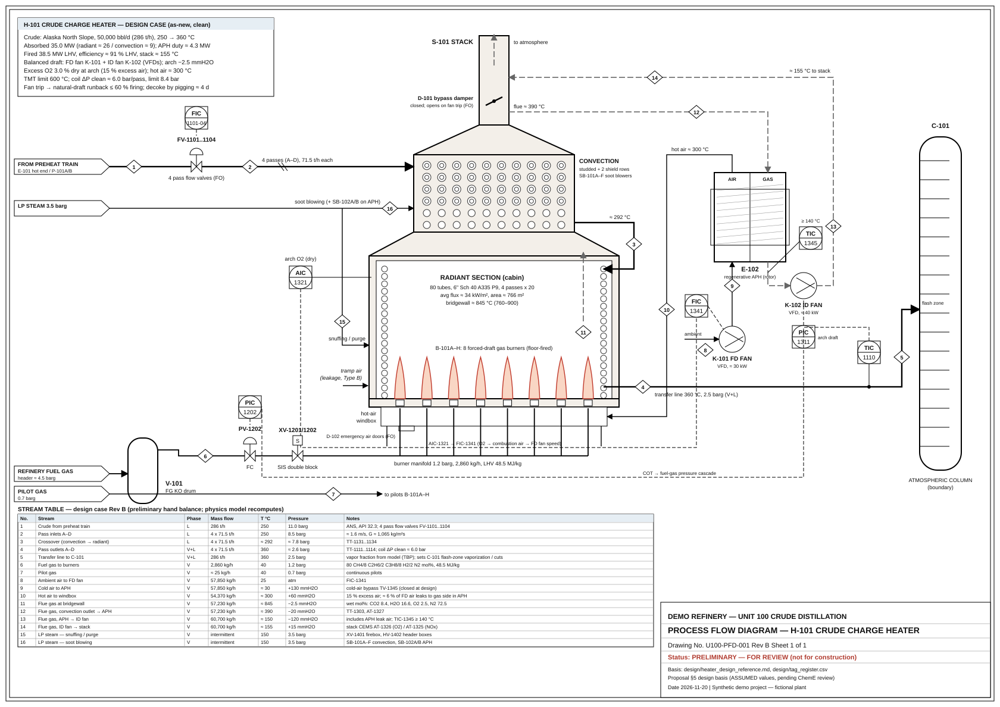

# Closing the Sim-to-Plant Gap: Fired Heater Calibration, Optimization & Explanation

A process simulation describes a plant **as designed**: clean tubes, no air leaks, perfect
instruments. Real plants degrade. An uncalibrated model drifts away from reality, and optimizing on
that model produces recommendations that fail on the real plant.

This project builds the full workflow on a refinery **crude charge heater**: estimate the heater's
current degraded condition from plant data, recommend the best operating settings and maintenance
timing within every safety limit, and explain each recommendation in terms an engineer can check.

The result it is designed to demonstrate:

> The same optimizer, run on the as-new model and on the calibrated model, gives different
> recommendations. Applied to the plant, the as-new recommendation violates limits. The calibrated
> one stays feasible and costs less.

---

## Status

**Documentation and design phase. There is no model code in the repository yet.**

| | |
|---|---|
| Proposal | Complete, see [docs/fired_heater_project_proposal.md](docs/fired_heater_project_proposal.md) |
| Design basis | Preliminary hand calculations, out for chemical-engineer review |
| Drawings | PFD and three P&IDs, Rev B |
| Plant document library | 42 documents, Rev B |
| Physics model | Not started, this is Phase 1 |

Every number in `design/` is an assumption or a hand calculation until the physics model recomputes
it. Where the model and the design reference disagree, the model wins and the reference is updated.

---

## The problem, stated precisely

> **Given** plant data, **estimate** the heater's current degraded condition, **recommend** the
> optimal operating settings and maintenance timing within all limits using a physics-based model,
> and **explain** each recommendation by the specific condition and binding limit driving it,
> including when decoking is worth more than an operating change.

The idea the whole project rests on is separating what you decide from what degrades:

| Kind | Meaning | Examples |
|---|---|---|
| **Type A, decisions** | Knobs the operator or optimizer sets | Excess-O2 setpoint, decoke date. Stretch: arch draft setpoint |
| **Given conditions** | Set by production or weather | Crude rate, inlet temperature, COT target, crude assay, fuel gas composition, ambient |
| **Type B, degradation** | Equipment condition, not directly measured | Coke in the tubes, coking rate per crude, convection soot, tramp-air leak area, air-preheater seal leakage and fouling, O2 analyzer bias |

Closing the gap means calibrating Type B, not pinning Type A. The calibrated model reproduces how the
**degraded** plant responds while the decision variables stay free for the optimizer.

Calibration is physics-based rather than black box on purpose. A model curve-fitted to history only
knows the narrow band the plant has already run in, and the optimum usually sits outside it.
Physically meaningful parameters such as coke resistance, leak area and sensor bias extrapolate
correctly to settings the plant has never run.

---

## The unit

H-101, a crude charge heater at a fictional "Demo Refinery", Unit 100.



| Item | Design value |
|---|---|
| Charge | 50,000 bbl/d Alaska North Slope crude, 250 to 360 °C |
| Coil | 4 passes, 6 inch Sch 40 ASTM A335 P9, 80 radiant tubes, 766 m² |
| Absorbed duty | 35.0 MW, radiant / convection ≈ 74 / 26 % |
| Average radiant flux | ≈ 34 kW/m², clean start-of-run hottest TMT ≈ 430 °C |
| Draft | Balanced, FD fan K-101 and ID fan K-102, both on VFDs |
| Air preheater | Regenerative (Ljungström) E-102, air 30 to 300 °C, ≈ 4.3 MW |
| Efficiency | ≈ 91 % LHV, fired 38.5 MW, stack ≈ 155 °C |
| Excess O2 | 3.0 % dry at the arch, operating range 2 to 4 % |

Full heat and material balance, stream table, control loops, trip logic and the 86-tag instrument
register are in [design/](design/).

### Why this unit

Fired heaters are among the largest energy consumers in a refinery, they degrade in several
independent ways at once, and they contain a genuine trade-off: low excess air saves fuel but risks
CO, while coke forces tube metal temperatures up until a decoke is unavoidable. Operate harder now,
or decoke sooner? On top of that, operation changes degradation, since hotter tube walls coke faster
and higher velocity cokes slower, so today's decision changes tomorrow's condition.

---

## Data

No real heater data is available, so both datasets are synthetic, under one strict rule.

| Dataset | What it is |
|---|---|
| **Simulation dataset** | The physics model run with as-new Type B values. What engineering software "thinks" the heater does |
| **Plant dataset** | A separate, richer "truth" simulator with hidden degradation, events and sensor noise. About 18 months hourly, covering one to two decoke cycles |

**The rule: the plant simulator must differ structurally from the model.** If both came from the same
equations, calibration would look perfect and prove nothing. The plant simulator adds flow
maldistribution across 4 passes, true per-crude coking rates, decokes that remove only about 95 % of
the coke, a drifting O2 analyzer bias, a sudden tramp-air step, detached skin thermocouples, and
time-correlated noise. The model has none of these and has to discover them.

A hidden truth table of the real Type B values over time is generated as well. Calibration never
reads it. It is only the answer key for grading.

### Crude assays

Real and public, from ExxonMobil Crude Summary Reports. Only the extracted key properties are stored,
with source and assay date. The raw PDFs are not redistributed.

| Role | Crude | API | MCR (wt%) | C7 asphaltenes (wt%) | Vol % distilled at 360 °C |
|---|---|---|---|---|---|
| Light | WTI Light, Texas | 47.4 | 0.1 | 0.0 | 78.6 |
| Medium (design) | Alaska North Slope | 32.3 | 4.7 | 1.9 | 60.0 |
| Heavy | Kearl, Alberta | 19.8 | 9.7 | 5.7 | 37.4 |

The spread in MCR and asphaltenes gives a wide coking-tendency range. The spread in distillation gives
very different outlet vaporization at the same coil outlet temperature.

---

## How each degradation is identified

Calibration works because each degradation leaves a different signature in the data:

| Degradation | Fingerprint |
|---|---|
| Tube coke | Tube metal temperature up **and** coil pressure drop up, together |
| Convection soot | Convection outlet temperature up, tubes normal |
| Tramp air below the arch | Fuel per unit duty up, CO possible at a normal arch O2 reading |
| Convection casing ingress | Air-preheater inlet O2 rises above arch O2 |
| Air-preheater seal leakage | Stack O2 rises above APH inlet O2, ID fan load up, APH flue outlet cooler |
| Air-preheater fouling | APH gas-side pressure drop up, hot-air temperature down, ID fan load up |
| O2 analyzer bias | O2 reading shifted, everything else consistent with a different true O2 |

Two of these are a known trap. At a constant O2 setpoint, tramp air and analyzer bias look almost
identical. The workflow is built to detect that it cannot separate them, say so, and recommend a
small O2 step test that resolves it, rather than guessing.

---

## Repository layout

```
docs/          proposal (markdown + PDF), PFD and P&IDs as SVG and a combined A3 PDF
design/        heat and material balance, stream table, control loops, trips,
               operating limits, 86-tag instrument register, equipment list
crudes/        extracted assay properties with source and assay date
heater_docs/   42 synthetic controlled plant documents (datasheets, SOPs, controls,
               maintenance, safety, troubleshooting) for document retrieval
scripts/       diagram generator, proposal PDF build
```

Planned, not yet present: `heater_model/` (physics), `heater_plant/` (truth simulator),
`tests/`, and the demo page.

---

## Roadmap

| Phase | Build | Demonstrable output |
|---|---|---|
| 1 | Physics model and unit tests | What-if plots: O2 against efficiency and CO, coke against TMT and pressure drop |
| 2 | Plant simulator and both datasets | The gap growing between as-new simulation and plant |
| 3 | Calibration: rolling windows, confidence intervals, identifiability, step test | Estimated against true degradation over time |
| 4 | Optimization: O2 setpoint, decoke timing, run-length forecast | As-new against calibrated recommendations applied to the plant |
| 5 | Explanation: audit trail, document citations, rendered report | Investigation report and summary |
| 6 | Demo page and documentation | Shareable page |

---

## Assumptions and limitations

Stated up front, because the project is about trustworthy recommendations.

- **The data is synthetic.** Results are only as credible as the plant simulator's realism, which is
  why it is built to differ from the model. Validation on real heater data is the natural next step.
- **The design basis is assumed.** Fuel gas composition, TMT limit, coking constants, decoke cost and
  prices are typical values, reported with sensitivity bands, not vendor data. Every assumed number
  carries its source or an explicit `ASSUMED` tag.
- **Vaporization is simplified.** Vapor fraction and enthalpy come from assay correlations rather than
  a rigorous flash, with a simple two-phase pressure-drop multiplier.
- **Steady state.** Fast dynamics are ignored and hourly data is treated as quasi-steady.
- **Downstream is not modelled yet.** Coil outlet temperature and vaporization set flash-zone
  conditions and therefore the atmospheric column's cut points and yields. COT is treated as a given
  target here. The coupling is flagged in explanations and is an open item.
- **The plant documents are written for the demo.** They describe a fictional refinery and
  intentionally do not reveal the plant simulator's hidden degradations.

---

## Regenerating the artifacts

```bash
python3 scripts/draw_diagrams.py      # PFD and P&ID SVGs
./scripts/build_proposal_pdf.sh       # proposal PDF (needs pandoc and Chrome)
```

The proposal stylesheet is `docs/proposal.css`. It resolves to Helvetica Neue on macOS and falls back
to DejaVu Sans elsewhere, so the PDF looks slightly different depending on where it is built.

---

## References

- API Standard 560, *Fired Heaters for General Refinery Service*
- API Standard 530, *Calculation of Heater-tube Thickness in Petroleum Refineries*
- Ebert, W. and Panchal, C.B. (1997), threshold fouling model for crude oil
- Lobo, W.E. and Evans, J.E. (1939), radiant-section heat transfer in fired heaters
- ExxonMobil Crude Summary Reports (public crude assays)

---

## License

MIT, see [LICENSE](LICENSE).
